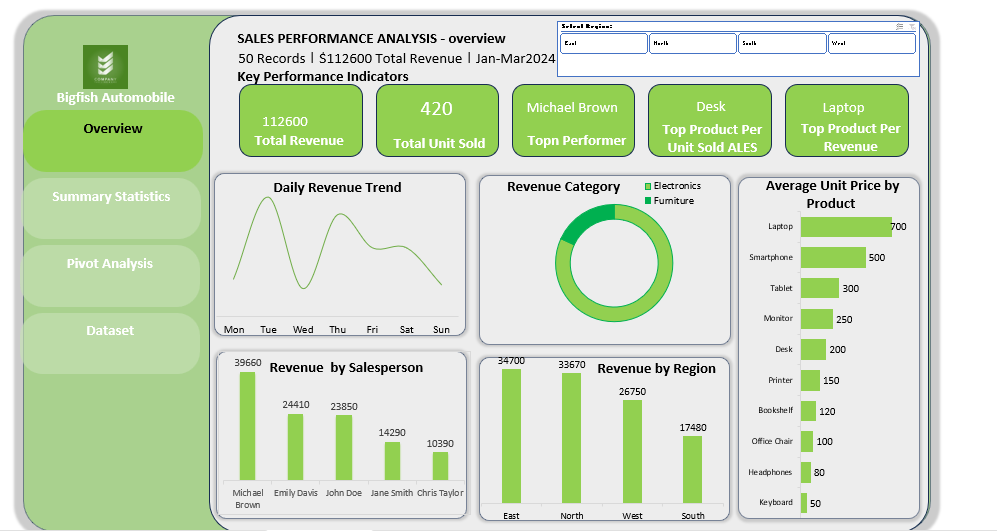
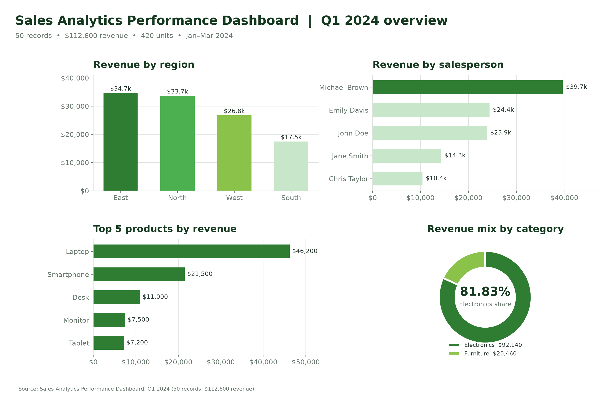
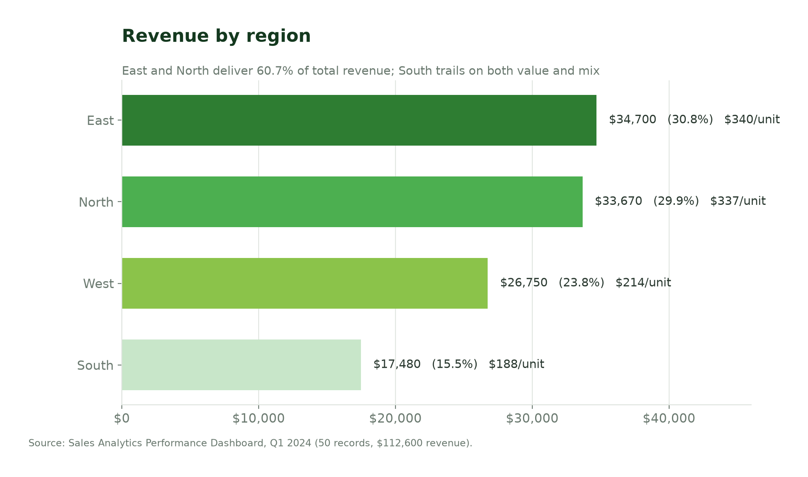
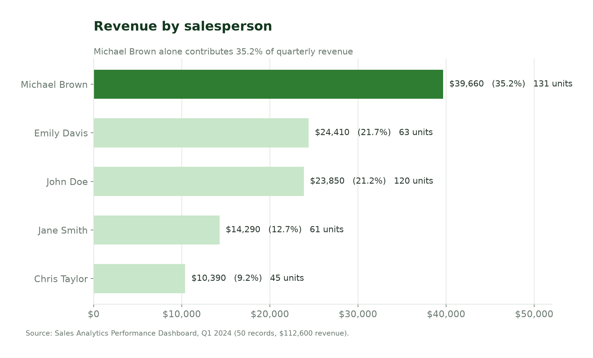
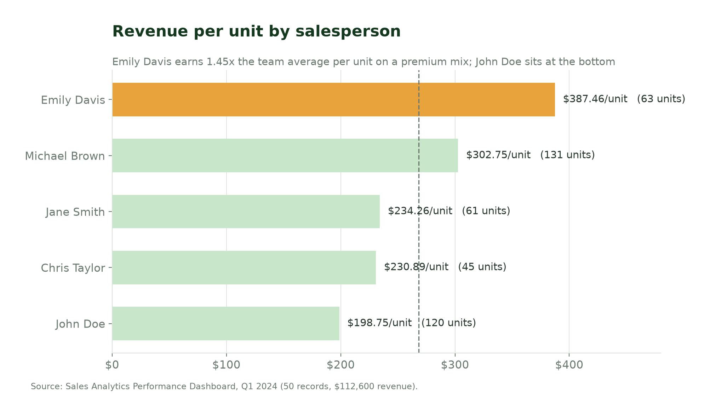
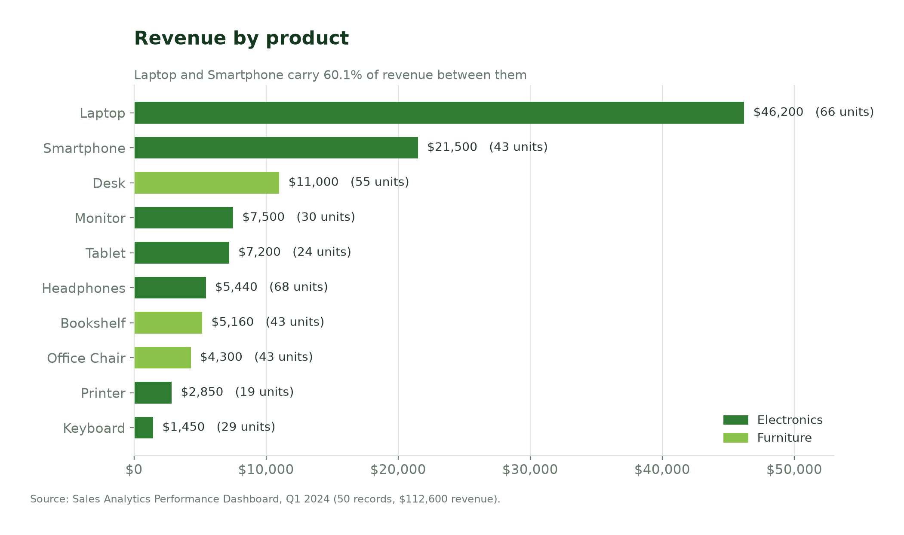
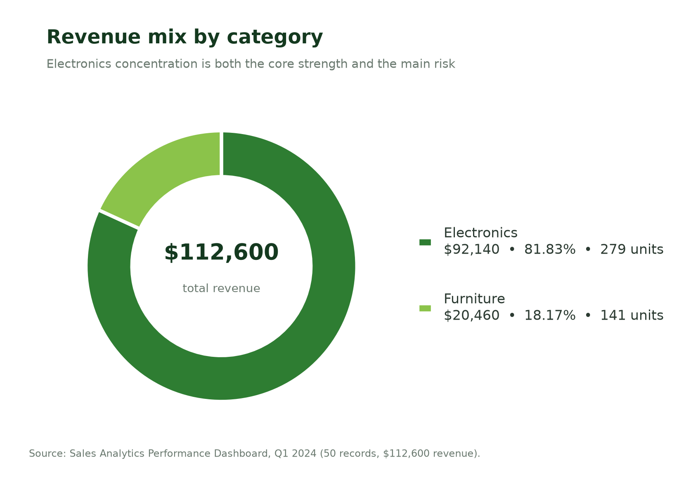
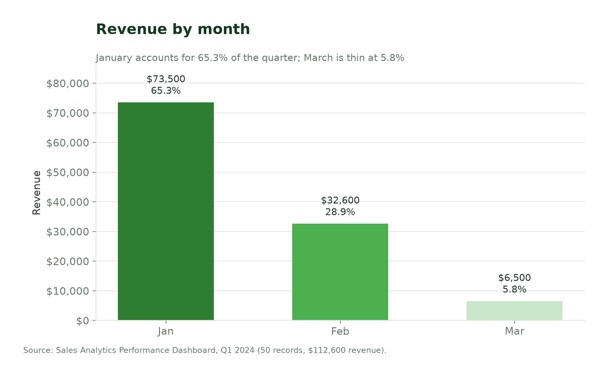
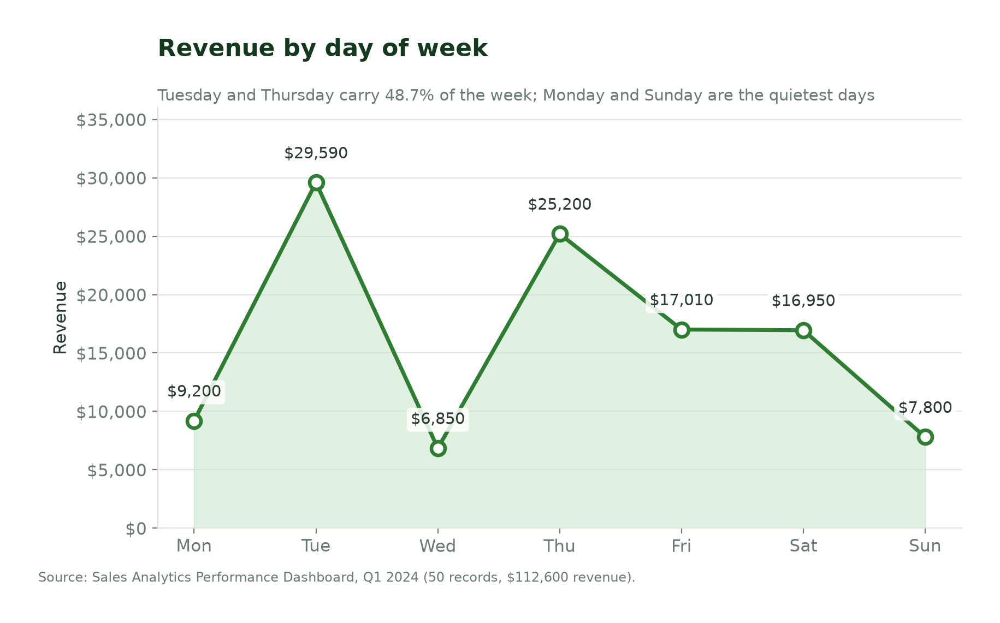
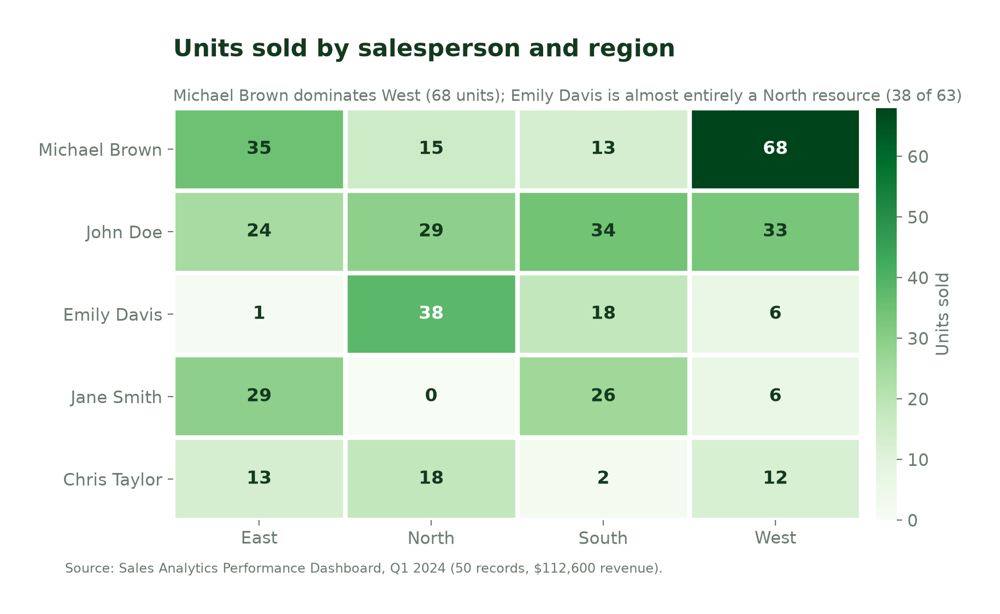

<div align="center">

# Sales Analytics Performance Dashboard

**Where is Q1 2024 revenue concentrated, and which levers can lift the total?**

An Excel pivot-table and dashboard analysis of 50 sales transactions across four regions,
five salespeople and ten products — rebuilt here as a reproducible, documented analytics project.

[](#the-dashboard)
[](#reproduce-the-analysis)
[](#at-a-glance)
[](#at-a-glance)
[](LICENSE)

[Overview](#overview) · [At a glance](#at-a-glance) · [Findings](#what-the-data-says) ·
[Recommendations](#recommendations) · [Repository](#repository-contents) · [Reproduce](#reproduce-the-analysis)

</div>

---



## Overview

A sales organisation had one quarter of transaction data and a simple question: **where is
performance concentrated, and which levers can lift overall results?** This project answers it with
descriptive analysis of 50 records covering January–March 2024, using Excel pivot tables and a
single-page dashboard.

The analysis deliberately avoids causal claims. With five salespeople, ten products and one
quarter, the output is a set of relative rankings and value-mix signals that leadership can act on
and then test.

| Question | Short answer |
| --- | --- |
| Which regions contribute most and least? | East ($34,700) and North ($33,670) together deliver **60.7%** of revenue; South contributes **15.5%** |
| Who leads on absolute revenue? | **Michael Brown** — $39,660, or **35.2%** of the quarter, on 131 units |
| Who leads on revenue intensity? | **Emily Davis** — **$387.46 per unit**, 45% above the team average |
| Which products and categories drive value? | **Laptops** alone are **41.0%** of revenue; **Electronics** is **81.8%** of the total |
| Where should leadership focus? | South territory support, knowledge transfer from Brown and Davis, and deliberate management of Electronics concentration |

## At a glance

| Metric | Value |
| --- | ---: |
| Reporting period | Jan – Mar 2024 |
| Transactions in scope | 50 records |
| Total revenue | **$112,600** |
| Units sold | **420** |
| Average revenue per unit | **$268.10** |
| Regions / salespeople / products | 4 / 5 / 10 |
| Product categories | 2 (Electronics, Furniture) |

> **Business question:** *How can a business access its sales transaction data across different
> products, categories and regions?*

## The dashboard

The Excel dashboard consolidates the quarter into five KPI cards and five views — daily revenue
trend, category mix, average unit price by product, revenue by salesperson, and revenue by region.
The overview below is rebuilt directly from the tables in [`data/`](data), so it can be regenerated
at any time with `python analysis/generate_charts.py`.



The underlying pivot tables are preserved in [`images/`](images) exactly as published, so every
figure in this repository can be traced back to a source table:

| Source screenshot | Contents |
| --- | --- |
| [`01-data-extract.png`](images/01-data-extract.png) | Record-level extract: date, day, region, salesperson, product, category, units, unit price, total sales |
| [`02-region-salesperson-category-pivots.png`](images/02-region-salesperson-category-pivots.png) | Revenue by region, revenue by salesperson, units by product, category mix |
| [`03-units-monthly-daily-pivots.png`](images/03-units-monthly-daily-pivots.png) | Units by region × salesperson, monthly revenue, daily revenue, product revenue |
| [`04-product-revenue-per-unit-pivots.png`](images/04-product-revenue-per-unit-pivots.png) | Product revenue and revenue per unit |
| [`05-dashboard-overview.png`](images/05-dashboard-overview.png) | Final single-page Excel dashboard |

## What the data says

### 1. Two regions carry the quarter; South lags on both value and mix



East ($34,700) and North ($33,670) are within $1,030 of each other and together produce 60.7% of
revenue. The more interesting contrast is **West versus South**:

- West sells the **most units of any region (125)** yet ranks only third on revenue, at **$214 per
  unit** — a volume territory with a low-value mix.
- South sells 93 units and returns **$17,480**, the lowest revenue *and* the lowest revenue per unit
  (**$188**). It is not just a smaller territory; it is a thinner one.

Territory size, coverage and local demand are not in the dataset, so these are mix signals rather
than verdicts on individual performance.

### 2. One salesperson drives a third of revenue — but not the best value mix





Michael Brown produces **$39,660 (35.2%)** from 131 units, 1.62× the revenue of the next
salesperson. Emily Davis produces **$24,410** from only 63 units — and at **$387.46 per unit**
achieves the highest value intensity in the team, **45% above the $268.10 average**.

John Doe is the mirror image of Davis: 120 units, the second-highest volume, but the **lowest
revenue per unit ($198.75)**. Brown and Davis are therefore solving two different problems —
throughput and mix — and both are worth codifying.

### 3. Electronics, and Laptops in particular, is the business





Electronics generates **$92,140 (81.83%)** of revenue against Furniture's **$20,460 (18.17%)**.
Within Electronics, **Laptops alone are $46,200 (41.0%)**; Laptop plus Smartphone account for
**60.1%**.

Volume tells a different story: **Headphones lead unit sales (68)** but contribute only 4.8% of
revenue, followed by Laptops (66). **Printer is the smallest line** at 19 units and $2,850.

That gap between volume leaders and value leaders is the assortment question this dashboard makes
visible: high-price, high-revenue products deserve protection, while high-volume, low-price lines
need margin data before they get more shelf space.

### 4. The quarter is front-loaded and mid-week weighted





January alone is **$73,500 (65.3%)** of the quarter; March is **$6,500 (5.8%)**. February is 44% of
January's level. Without prior-period data it is not possible to say whether this is seasonality,
pipeline timing or a data-coverage issue — but a quarter that fades this sharply is worth a direct
check against the ledger.

At day level, **Tuesday ($29,590) and Thursday ($25,200)** together carry **48.7%** of revenue,
while **Wednesday ($6,850)** and **Sunday ($7,800)** are the quietest days.

### 5. Units are spread unevenly against revenue



The region × salesperson matrix shows how concentrated the book is: Michael Brown is effectively a
West resource (68 of 131 units), Emily Davis is almost entirely North (38 of 63), and Jane Smith
records **no North volume at all**. Chris Taylor's 45 units are split thinly across four regions.

## Recommendations

| # | Recommendation | Evidence | Suggested measure (90 days) |
| --- | --- | --- | --- |
| 1 | **Codify top-performer practice.** Turn Brown's throughput and Davis's premium mix into a shared playbook. | Brown: 35.2% of revenue; Davis: $387.46/unit vs $268.10 average | Playbook adopted by all five reps; track revenue per unit per rep |
| 2 | **Target South territory support** — pipeline quality, coverage and product mix, with Taylor and Smith first. | South: $17,480 and $188/unit, both lowest | South revenue and revenue per unit up against Q1 baseline |
| 3 | **Protect the Electronics/Laptop franchise** while widening Furniture. | Electronics 81.8%; Laptop 41.0% of revenue | No loss of Electronics revenue; Furniture share above 18.2% |
| 4 | **Review low-volume and low-value lines** with margin data before reordering. | Printer 19 units / $2,850; Keyboard $1,450 | Retain / promote / phase-out decision documented per SKU |
| 5 | **Reconcile and complete the dataset.** Tie monthly and daily figures to the grand total and add order counts and cost. | Source tables contain totals that do not self-reconcile | Reconciled extract delivered; margin and order-count fields added |

Recommendation 1 is the cheapest to run: both behaviours already exist inside the team, so the
experiment is transfer, not investment.

## Repository contents

```text
sales-analytics-performance-dashboard/
├── README.md                     This overview
├── LICENSE                       MIT licence
├── requirements.txt              Python dependencies for chart reproduction
├── analysis/
│   ├── build_tables.py           Rebuilds every CSV and asserts the totals reconcile
│   └── generate_charts.py        Regenerates all nine figures in charts/
├── charts/                       Publication-ready figures (PNG, 200 dpi)
├── data/                         Analysis-ready aggregates (CSV)
├── docs/
│   ├── data-dictionary.md        Field definitions and derivations
│   └── data-quality-notes.md     Reconciliation trail and known limitations
├── images/                       Original pivot tables and dashboard, as published
└── reports/
    └── sales-analytics-performance-dashboard.md   Full written report
```

## Reproduce the analysis

Requires Python 3.10+.

```bash
git clone https://github.com/Christian-Iyayi/sales-analytics-performance-dashboard.git
cd sales-analytics-performance-dashboard

python -m venv .venv && source .venv/bin/activate   # Windows: .venv\Scripts\activate
pip install -r requirements.txt

python analysis/build_tables.py     # rebuilds data/*.csv, validates totals
python analysis/generate_charts.py  # rebuilds charts/*.png
```

`build_tables.py` fails loudly if any table stops reconciling to **$112,600** in revenue or
**420** units, and if any product line breaks the rule `units × unit price = revenue`. The tables
double as a regression test for the published numbers.

## Data quality and limitations

The analysis is transparent about what the source data can and cannot support — the full trail is
in [`docs/data-quality-notes.md`](docs/data-quality-notes.md).

- **Aggregates only.** Raw transactions, customer identifiers, order counts, cost and margin were
  not provided, so profitability cannot be assessed.
- **Small sample.** 50 records across one quarter; individual rankings are sensitive to a few large
  deals.
- **Reconciled discrepancies.** Some secondary totals in the source screenshots did not
  self-reconcile. Every table here was rebuilt so that it does; each adjustment is documented.
- **No causal claims.** Region and salesperson effects are confounded with territory size,
  product mix and account assignment, none of which are observable here.

## Author

**Christian Iyayi** — data analytics portfolio
[GitHub](https://github.com/Christian-Iyayi) · [Medium](https://medium.com/@krisnice2002gmail.com)

Originally published as
[Sales Analytics Performance Dashboard](https://medium.com/@krisnice2002gmail.com/sales-analytics-performance-dashboard-316c17710990).

## License

Released under the [MIT License](LICENSE). The source dashboard and pivot screenshots are the
author's own work; figures in `charts/` are generated from the aggregated tables in `data/`.
