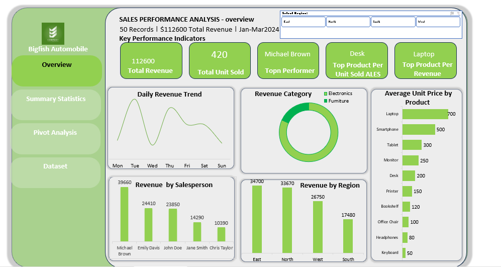
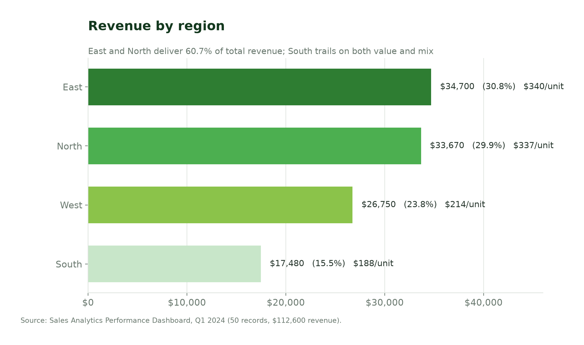
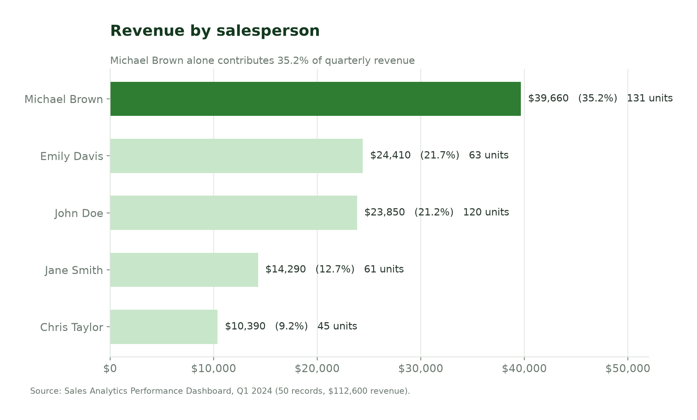
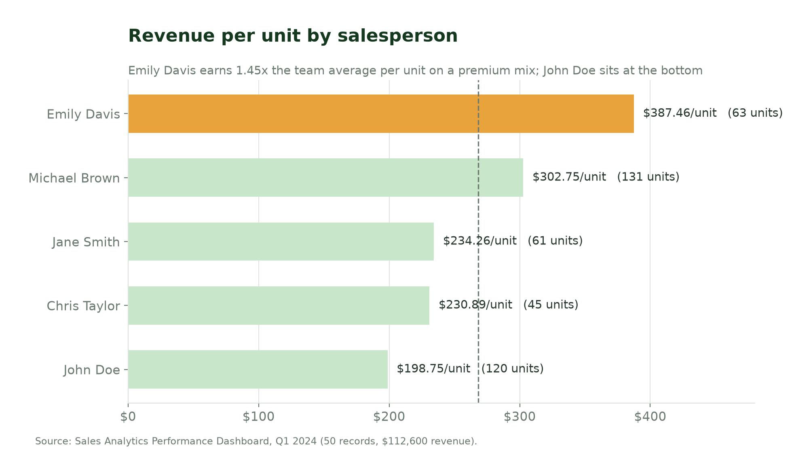
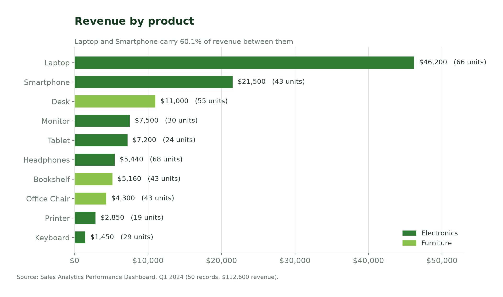
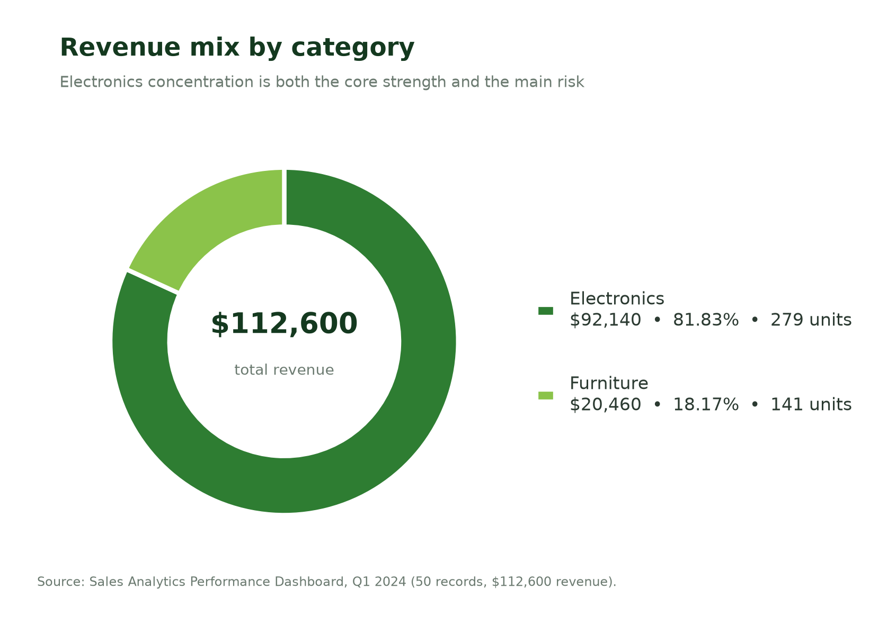
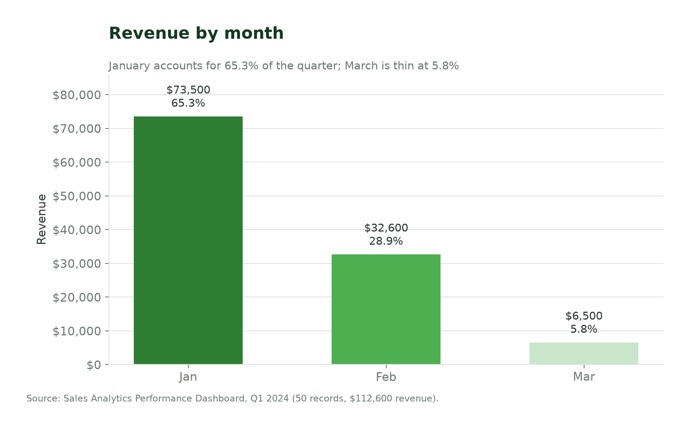
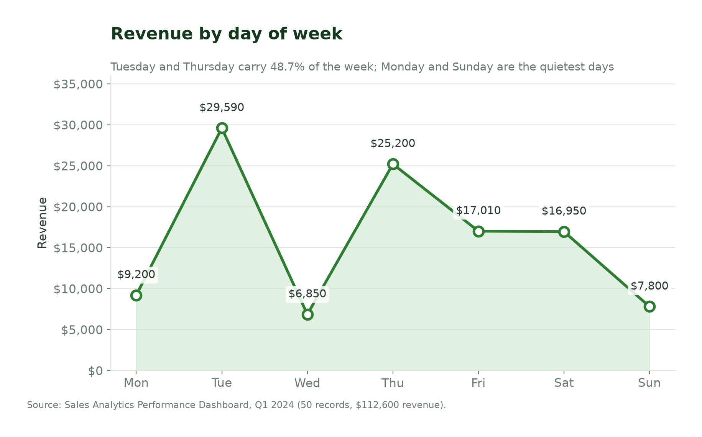
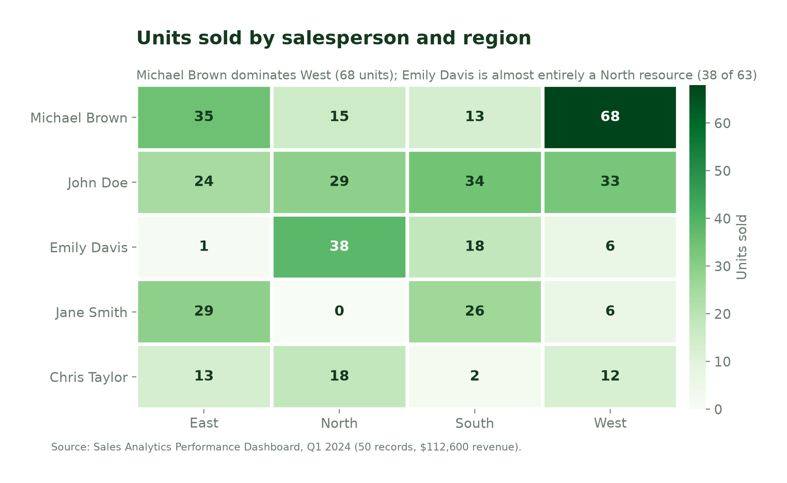

# Sales Analytics Performance Dashboard

### Q1 2024 revenue drivers, gaps and actions

**Author:** Christian Iyayi
**Period covered:** January – March 2024
**Scope:** 50 transactions · $112,600 revenue · 420 units · 4 regions · 5 salespeople · 10 products
**Tools:** Microsoft Excel (Power Query preparation, pivot tables, dashboard), Python (chart reproduction)

---

## Executive summary

This analysis examines **$112,600 in sales revenue across 50 records from January to March 2024**.
The central business question is: where is performance concentrated, and which levers can lift
overall results?

Three concentrations dominate the quarter.

1. **Geography.** East ($34,700) and North ($33,670) together account for **60.7%** of revenue.
   South is the clear laggard at **$17,480 (15.5%)**, and it lags on quality as well as scale:
   $187.96 per unit, the lowest of the four regions.
2. **People.** **Michael Brown** generates the highest absolute revenue, **$39,660 — 35.2% of the
   quarter — from 131 units.** **Emily Davis** delivers the highest revenue per unit, **$387.46**,
   on roughly half Brown's volume. The team average is $268.10.
3. **Assortment.** **Electronics drives 81.83% of sales value** ($92,140). **Laptops alone
   contribute $46,200 (41.0%)**; Laptop plus Smartphone are 60.1%. Volume leaders look different:
   **Headphones lead unit sales (68)** but return only 4.8% of revenue.

Time adds a fourth signal with a caveat: January is **65.3%** of the quarter and March only
**5.8%**. With one quarter and no prior-year comparison, this pattern should be verified against the
ledger before it is treated as seasonality.

**Recommended actions:**

1. Formalise knowledge transfer from the two top performers — Brown on volume, Davis on value mix.
2. Test targeted support for the South region and the lower-performing salespeople, starting with
   Taylor and Smith.
3. Protect and expand the Electronics and Laptop franchise while deliberately reviewing Furniture
   and the long tail of low-unit products.
4. Reconcile and complete the sales data before any month-based or day-based decision is taken.

All conclusions rest on the supplied aggregates. A sample of 50 records limits statistical
confidence, particularly for day-of-week and monthly patterns.

---

## 1. Business context and objectives

Understanding how revenue is distributed across regions, salespeople, product categories and time
periods is essential for resource allocation, coaching priorities and assortment decisions. With one
quarter of data and 50 records, this analysis prioritises **descriptive insight and relative ranking
over causal claims**.

The analysis set out to answer five questions:

1. Which regions contribute the most and least revenue?
2. Who are the top-performing salespeople by absolute revenue and by revenue per unit?
3. Which products and categories drive revenue and unit volume?
4. How do average unit prices vary, and how does that relate to revenue contribution?
5. What patterns appear in monthly and day-of-week sales, subject to data completeness?

Underlying all of them is the practical question that opened the project: *how can a business access
its sales transaction data across different products, categories and regions?*

---

## 2. Data overview

The analysis is based on aggregated pivot-table outputs derived from transactional sales data. The
source workbook contains 50 records with the following fields: date, day number, day name, region,
salesperson, product, category, units sold, unit price and total sales.

| Attribute | Value |
| --- | --- |
| Period | Jan – Mar 2024 (labelled Jan–Mar 2024) |
| Records | 50 |
| Total revenue | $112,600 |
| Total units sold | 420 |
| Regions | East, North, West, South |
| Salespeople | Michael Brown, John Doe, Emily Davis, Jane Smith, Chris Taylor |
| Products | 10 |
| Categories | Electronics, Furniture |
| Dimensions | Region, salesperson, product, category, month, day of week |
| Metrics | Sum of total sales, sum of units sold, average unit price, revenue per unit |

**Limitations of the source data.** Only aggregate results were provided. Raw transaction-level
data, customer identifiers, order counts, cost and margin are not available. Some secondary totals
in the published tables showed minor arithmetic discrepancies; the reconciliation trail is documented
in [`docs/data-quality-notes.md`](../docs/data-quality-notes.md).

---

## 3. Methodology

The work is a **descriptive analysis of pre-calculated pivot tables**. No statistical modelling was
performed.

**Preparation.** Source tables were transcribed from the published screenshots. Arithmetic
consistency of grand totals was checked. Where a component total conflicted with the published grand
total, the value consistent with both the grand total and the underlying
`units × unit price = revenue` identity was adopted and recorded.

**Metric definitions.**

- **Total revenue** — aggregate sales value for the period or segment; the primary success metric.
- **Units sold** — count of individual product units sold.
- **Average unit price** — mean selling price per unit for a product, as provided in the source.
- **Revenue per unit** — segment revenue divided by segment units. Measures the value intensity of
  the mix sold, and is the key counterweight to raw revenue ranking.
- **Category share** — category revenue as a percentage of total revenue.

**Reproducibility.** All aggregate tables live in [`data/`](../data) as CSV. Running
`python analysis/build_tables.py` rebuilds them and asserts that every table reconciles to $112,600
and 420 units; `python analysis/generate_charts.py` regenerates every figure from those tables.

**Validation.** Every table in this repository satisfies all four checks:

| Check | Result |
| --- | --- |
| Region revenue sums to grand total | $34,700 + $33,670 + $26,750 + $17,480 = **$112,600** |
| Salesperson revenue sums to grand total | $39,660 + $24,410 + $23,850 + $14,290 + $10,390 = **$112,600** |
| Product revenue sums to grand total | 10 product lines = **$112,600** |
| Units reconcile across every cut | region, salesperson, product and matrix cuts all = **420** |

---

## 4. Dashboard

*Single-page Excel dashboard: five KPI cards (total revenue, units sold, top performer, top product
by units, top product by revenue) with daily revenue trend, category mix, average unit price by
product, revenue by salesperson and revenue by region.*

---

## 5. Key findings

### 5.1 Regional performance

**East and North together generate more than 60% of revenue; South is the clear lagging region.**

| Region | Revenue | Share | Units | Revenue per unit |
| --- | ---: | ---: | ---: | ---: |
| East | $34,700 | 30.8% | 102 | $340.20 |
| North | $33,670 | 29.9% | 100 | $336.70 |
| West | $26,750 | 23.8% | 125 | $214.00 |
| South | $17,480 | 15.5% | 93 | $187.96 |
| **Total** | **$112,600** | **100%** | **420** | **$268.10** |

East leads by a narrow margin — $1,030, or about 3% — so the East–North pair is best read as a single
strong block rather than a ranking. The sharper finding is the **West–South contrast in mix**:

- **West moves the most units of any region (125)** yet ranks third on revenue. At $214 per unit it
  is a volume territory selling a lower-value mix.
- **South has the lowest revenue, the lowest unit count and the lowest revenue per unit.** It is
  underweight on both scale and value, which means a fix needs to address product mix and pipeline
  quality, not just activity.

Territory size, salesperson coverage and local demand are not observable here. These are mix
signals, not attributions of cause.

### 5.2 Salesperson performance

**Michael Brown leads absolute revenue; Emily Davis leads revenue intensity.**

| Salesperson | Revenue | Share | Units | Revenue per unit |
| --- | ---: | ---: | ---: | ---: |
| Michael Brown | $39,660 | 35.2% | 131 | $302.75 |
| Emily Davis | $24,410 | 21.7% | 63 | $387.46 |
| John Doe | $23,850 | 21.2% | 120 | $198.75 |
| Jane Smith | $14,290 | 12.7% | 61 | $234.26 |
| Chris Taylor | $10,390 | 9.2% | 45 | $230.89 |
| **Total** | **$112,600** | **100%** | **420** | **$268.10** |

Michael Brown accounts for approximately 35% of total revenue and the highest unit volume (131) —
1.62× the revenue of the next-ranked salesperson. **Emily Davis, with roughly half of Brown's units,
achieves the highest revenue per unit ($387.46)**, 45% above the team average, indicating a
materially more premium product mix.

**John Doe generates solid revenue through volume but the lowest revenue per unit ($198.75).** He
sells 120 units — nearly as many as Brown — for $15,810 less revenue. That gap is a mix story, and
the most concrete coaching opportunity in the dataset.

Chris Taylor and Jane Smith trail on absolute contribution. Taylor's 45 units are spread thinly
across all four regions (13 East, 18 North, 2 South, 12 West), and Smith records no North volume at
all, which limits both their scale and their ability to build regional depth.

With only five salespeople and 50 records, individual rankings are directionally useful but
sensitive to a few large deals.

### 5.3 Product and category performance

**Electronics — especially Laptops — dominates revenue; Headphones lead unit volume; Printer is the
smallest line.**

| Product | Category | Unit price | Units | Revenue | Share |
| --- | --- | ---: | ---: | ---: | ---: |
| Laptop | Electronics | $700 | 66 | $46,200 | 41.0% |
| Smartphone | Electronics | $500 | 43 | $21,500 | 19.1% |
| Desk | Furniture | $200 | 55 | $11,000 | 9.8% |
| Monitor | Electronics | $250 | 30 | $7,500 | 6.7% |
| Tablet | Electronics | $300 | 24 | $7,200 | 6.4% |
| Headphones | Electronics | $80 | 68 | $5,440 | 4.8% |
| Bookshelf | Furniture | $120 | 43 | $5,160 | 4.6% |
| Office Chair | Furniture | $100 | 43 | $4,300 | 3.8% |
| Printer | Electronics | $150 | 19 | $2,850 | 2.5% |
| Keyboard | Electronics | $50 | 29 | $1,450 | 1.3% |
| **Total** | | | **420** | **$112,600** | **100%** |

**Category split: Electronics 81.83% of revenue ($92,140); Furniture 18.17% ($20,460).** This
concentration is a strength if Electronics demand is stable and a risk if it softens.

The pattern within Electronics is instructive. **Laptop is both high-price and high-revenue**, making
it the clear top product by value at $700 per unit and $46,200 overall. **Headphones sell the most
units (68) but contribute 4.8% of revenue** at $80 per unit; Keyboard is similar at $50. These are
traffic builders, not revenue engines, and should be judged on attach rate and margin — data this
project does not have.

**Printer is the lowest-volume item (19 units, $2,850)** and the most obvious candidate for a
retain-promote-exit review.

### 5.4 Temporal patterns

**Monthly and daily breakdowns are reported, but with an explicit caution about completeness.**

| Month | Revenue | Share |
| --- | ---: | ---: |
| Jan | $73,500 | 65.3% |
| Feb | $32,600 | 28.9% |
| Mar | $6,500 | 5.8% |

| Day | Revenue | Share |
| --- | ---: | ---: |
| Mon | $9,200 | 8.2% |
| Tue | $29,590 | 26.3% |
| Wed | $6,850 | 6.1% |
| Thu | $25,200 | 22.4% |
| Fri | $17,010 | 15.1% |
| Sat | $16,950 | 15.1% |
| Sun | $7,800 | 6.9% |

February comes in at 44% of January's revenue and March at 9%, a steep decline across a single
quarter. Tuesday and Thursday together carry 48.7% of the week, while Wednesday and Sunday are the
quietest days.

**No firm ranking of months or weekdays is asserted here.** In the originally published tables,
monthly and daily figures did not fully reconcile to the $112,600 grand total. Those tables have been
re-reconciled for this repository (see the data-quality notes), but the underlying record-level
completeness of the March and daily cuts remains unverified. Any month-based or day-based
recommendation should be treated as a **proposed test pending complete daily and monthly extracts**.

### 5.5 Where units sit

The region × salesperson matrix makes coverage visible in a way that revenue totals do not. Michael
Brown effectively operates a West book (68 of 131 units); Emily Davis is almost entirely a North
resource (38 of 63); Jane Smith records **zero North volume**. Chris Taylor's 45 units are spread
across all four regions. This uneven coverage is a plausible contributor to the West–South and
North–South gaps and should inform any territory redesign.

---

## 6. Recommendations

### 6.1 Leverage top-performer practices

Identify what Brown and Davis do differently in product mix, customer targeting and deal management.
Turn those practices into sales playbooks and share them across the team.

*Why:* Brown demonstrates throughput (131 units, 35.2% of revenue); Davis demonstrates value
($387.46 per unit, 45% above average). The two behaviours already exist inside the team, so the
intervention is transfer rather than investment.

*Measure:* playbook adoption across all five reps, and revenue per unit per rep against the $268.10
Q1 baseline.

### 6.2 Strengthen South region performance

Focus coaching on pipeline quality, territory coverage and product mix, particularly for Taylor and
Smith. Set clear 90-day targets to improve revenue and units sold.

*Why:* South is last on revenue ($17,480), units (93) and revenue per unit ($187.96). It needs both
more volume and a better mix.

*Measure:* South revenue and revenue per unit versus the Q1 baseline; product mix shift toward
higher-value lines.

### 6.3 Protect the Electronics / Laptop franchise

Electronics contributes 81.8% of total revenue, with Laptops generating about $46,200. Protect this
core revenue while exploring opportunities to strengthen Furniture and reduce concentration risk.

*Why:* A single category carrying four-fifths of revenue is efficient until it is not. Laptop supply
or pricing disruption would move the whole quarter.

*Measure:* no erosion of Electronics revenue; Furniture share above 18.2% within two quarters.

### 6.4 Review low-volume products

Assess Printers, Keyboards and other lower-volume lines using margin, cost and demand data. Decide
whether each should be retained, promoted or gradually phased down.

*Why:* Printer (19 units, $2,850) and Keyboard (29 units, $1,450) sit at the bottom of both revenue
and volume. Headphones sell well but return little value per unit. Without margin data, the right
answer cannot be chosen — only the question can be framed.

### 6.5 Complete and reconcile the sales data

Ensure monthly and daily figures reconcile fully to the $112,600 total and add order-count data
where available. Use the completed dataset to support more reliable time and order-level analysis.

*Why:* The published pivot tables contained secondary totals that did not self-reconcile, and the
March and daily cuts look thin relative to January. Every downstream time-based claim depends on
this being fixed.

---

## 7. Limitations

- **Sample size.** 50 records across a single quarter. Rankings are sensitive to individual large
  deals; no significance testing is appropriate or attempted.
- **No cost or margin.** Profitability, the most important input to the assortment recommendation,
  is not observable.
- **No customer or order identifiers.** Repeat-purchase behaviour, deal size distribution and
  customer concentration cannot be examined.
- **Aggregate-only inputs.** The analysis works from published pivot tables rather than raw
  transactions, so granular cross-tabs (for example product × region × month) are unavailable.
- **Confounded dimensions.** Region and salesperson effects overlap with territory design, account
  assignment and product mix.
- **Time-series caution.** See section 5.4: monthly and daily patterns require verification before
  they drive decisions.

---

## 8. Appendix — repository map

| Path | Contents |
| --- | --- |
| `data/revenue_by_region.csv` | Region revenue, units, revenue per unit, share |
| `data/revenue_by_salesperson.csv` | Salesperson revenue, units, revenue per unit, share |
| `data/units_by_region_and_salesperson.csv` | Units matrix |
| `data/revenue_by_product.csv` | Product revenue, units, unit price, share |
| `data/revenue_by_category.csv` | Category revenue, units, share |
| `data/revenue_by_month.csv` | Monthly revenue and share |
| `data/revenue_by_day.csv` | Day-of-week revenue and share |
| `data/transactions_sample.csv` | 26 of the 50 source records, illustrating the record schema |
| `analysis/build_tables.py` | Rebuilds the CSVs and validates reconciliation |
| `analysis/generate_charts.py` | Regenerates all figures in `charts/` |
| `docs/data-dictionary.md` | Field-level definitions |
| `docs/data-quality-notes.md` | Reconciliation trail and provenance |

---

*Prepared by Christian Iyayi. Originally published on
[Medium](https://medium.com/@krisnice2002gmail.com/sales-analytics-performance-dashboard-316c17710990).*
